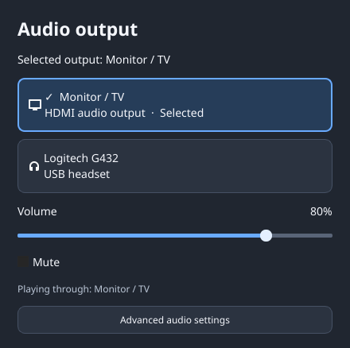
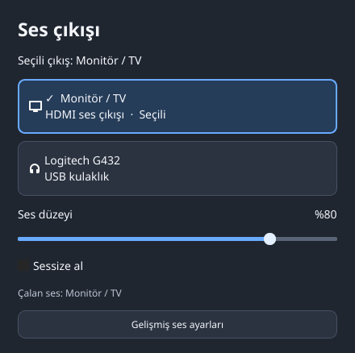

# Linux Audio Output Selector

A small Qt 6 audio output picker for Linux desktops. Select an output, move existing playback to it, adjust volume, and mute from one window. LXQt panel integration is optional.



## Features

- Shows the audio server's actual default output and where applications are playing.
- Switches the default output and moves existing playback streams to the selected device.
- Recognizes HDMI and Logitech G432 outputs, with server-provided descriptions for other devices.
- Uses Turkish when the system's first UI language is Turkish, and English for all other languages. There is no language menu or saved language override.
- Optional LXQt panel integration. No background service; device status refreshes every two seconds while the window is open.

## Requirements

Linux, Qt 6 Widgets (6.2 or newer), and a running PulseAudio-compatible server with `pactl` supporting JSON output. PipeWire with `pipewire-pulse` is supported. The advanced settings button opens `pavucontrol-qt`, which is optional for the picker itself.

Building requires CMake, a C++17 compiler, and Qt development files. Python 3 is optional for the locale tests. On Arch-based systems these are provided by `cmake`, `gcc`, `qt6-base`, `libpulse`, and optionally `python` and `pavucontrol-qt`. The app does not require a kernel, graphics driver, or distribution upgrade. On PS4 Linux, keep the distribution's compatible package set.

## Build and install

```sh
cmake -S . -B build -DCMAKE_BUILD_TYPE=Release -DCMAKE_INSTALL_PREFIX="$HOME/.local"
cmake --build build --parallel 2
ctest --test-dir build --output-on-failure
cmake --install build
```

Launch **Linux Audio Output Selector** from the application menu, or run:

```sh
~/.local/bin/linux-audio-output-selector
```

Installation stays in your home directory and needs no root privileges. It does not change system language, audio profiles, firmware, kernels, or disk settings.

If CMake is unavailable, the app can also be built directly with the existing compiler and `pkg-config`:

```sh
mkdir -p build
g++ -O1 -fPIC -pie -std=c++17 src/main.cpp -o build/linux-audio-output-selector $(pkg-config --cflags --libs Qt6Widgets)
python3 tests/test_locale.py build/linux-audio-output-selector
```

This direct compiler build was used on the PS4. Run `build/linux-audio-output-selector` to open it; CMake additionally provides installation and application-menu integration.

For optional LXQt integration, back up the panel configuration and set the panel's Mixer action to open the picker:

```sh
cp -n "$HOME/.config/lxqt/panel.conf" "$HOME/.config/lxqt/panel.conf.before-audio-selector"
~/.local/bin/linux-audio-output-selector --configure-panel
```

Selecting an output also keeps LXQt's stored volume-device selection in sync when its panel configuration exists. The integration follows LXQt 2.4.1's name-sorted device list; other panel versions have not been verified.

## Language behavior

Supported interface languages: **English and Turkish only**. All other system languages use English. There is no in-app language selector.

The first UI language reported by Qt determines the interface language. Standard session locale variables such as `LANG`, `LC_MESSAGES`, `LC_ALL`, and `LANGUAGE` are respected through Qt. A Turkish keyboard layout alone does not change the interface language. Restart the app after changing the system language.

```sh
linux-audio-output-selector --locale-info
```

This prints the detected language without contacting the audio server or opening a window. Automated tests cover Turkish, English, German, the C locale, and locale-variable precedence.

## Tested on PS4

Tested on PS4 Linux with LXQt 2.4.1, Qt 6.11.1, PipeWire 1.6.6 and WirePlumber 0.5.14. HDMI and Logitech G432 output routing were checked with a silent stream.

The app has no PS4-specific runtime dependency and is intended for Linux desktops with the requirements above. Other distributions, desktop environments, and hardware have not yet been verified.

## Limitations

The picker controls playback outputs, not microphone input or card profiles. Device changes affect existing playback streams as well as the default output. Server-supplied device names and diagnostic messages can follow the server's own language.

Developer commands:

```sh
# Save only the picker window as a PNG (requires a desktop and audio server).
linux-audio-output-selector --snapshot picker.png

# Switch outputs with digital silence and restore the original output.
# Requires no other applications playing audio; needs pacat.
linux-audio-output-selector --self-test
```

To uninstall, remove `~/.local/bin/linux-audio-output-selector` and `~/.local/share/applications/linux-audio-output-selector.desktop`. If panel integration was enabled, restore its backed-up configuration after closing the panel or use LXQt's panel settings to restore the previous Mixer command.

## Türkçe

Linux masaüstleri için sade bir ses çıkışı seçici. PS4 Linux üzerinde test edildi; PS4’e özel bir çalışma zamanı bağımlılığı yok. LXQt panel entegrasyonu isteğe bağlıdır. Sistem arayüz dili Türkçeyse Türkçe, diğer dillerde İngilizce açılır; uygulamada dil menüsü bulunmaz. Çıkış seçildiğinde mevcut uygulamaların sesi de o aygıta taşınır. Ses düzeyi ve sessize alma seçili çıkışı yönetir. Yukarıdaki komutlarla kullanıcı dizinine kurulabilir.



## License

[MIT](LICENSE)
